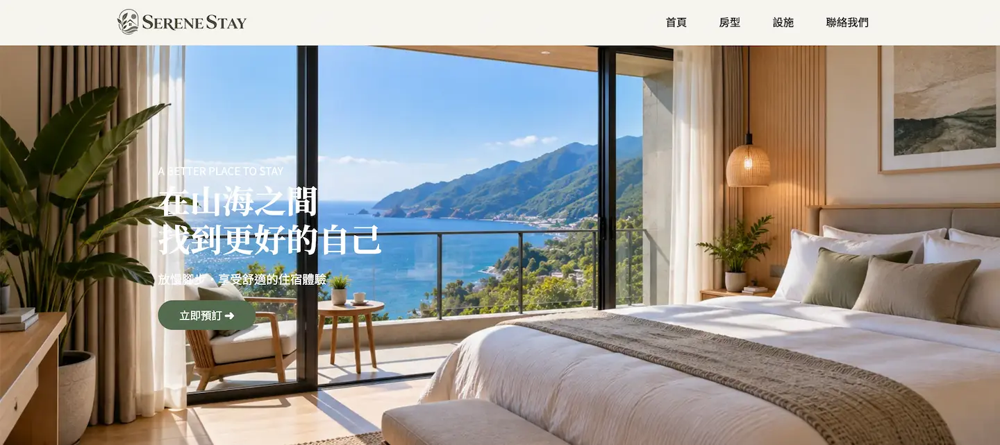
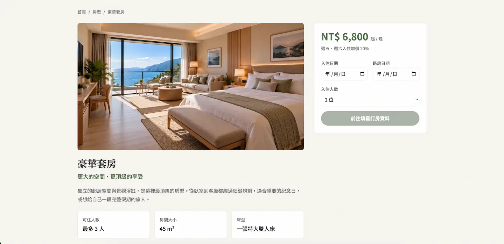
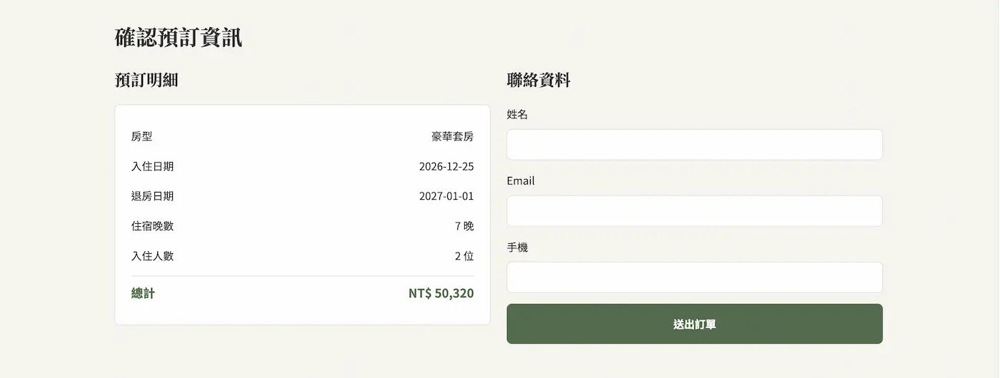

# Serene Stay

這是以 Vue 3 + Vite 開發的虛構飯店官方網站前端作品，從純 HTML/CSS 版型重構，包含房型介紹、設施服務，以及線上預訂流程。

🔗 Live Demo: https://serenestayhotel.vercel.app







## 功能特色

- 響應式設計（Mobile-First）
- 房型展示
- 設施介紹
- 漢堡選單
- 房型詳情頁（依網址參數載入房型資料）
- 預訂完成頁
- 找不到頁面時的 404 提示頁
- 訂房流程：選擇日期與人數、即時計算金額（含週末加價 20%）、聯絡資料驗證、送出訂單

## 技術棧

- Vue 3（Composition API、`<script setup>`）
- Vue Router
- SCSS（BEM 命名、mixin 管理斷點）
- Vite
- Vitest（單元測試）

## 快速開始

```
git clone https://github.com/dawningoo/serene-stay-vue.git
cd serene-stay-vue
npm install
cp .env.example .env
npm run dev
```

## 測試

```
npm run test
```

## 專案結構

```
src/
├── api/          API 呼叫
├── assets/       資源
├── components/   元件
├── composables/  共用邏輯
├── data/         資料
├── router/       路由
├── utils/        工具函式
└── views/        頁面
```

## 開發規劃

- [x] 首頁 Vue 化與響應式
- [x] 房型詳情
- [x] 訂房流程
- [ ] 房型列表：依人數篩選、價格排序、關鍵字搜尋
- [ ] 訂單查詢：以訂單編號與手機號碼查詢
- [ ] 聯絡電話支援國際區碼（區碼選單＋號碼欄位）

## 開發說明

此作品開發過程有使用 AI 作為學習與協作工具，範圍包含：概念說明、程式碼骨架與提示、debug 與 code review。我自行撰寫與修改程式碼、補上單元測試，並完成部署。

此作品使用公開之練習用 API，訂單資料可被他人瀏覽，請勿輸入真實個資。
